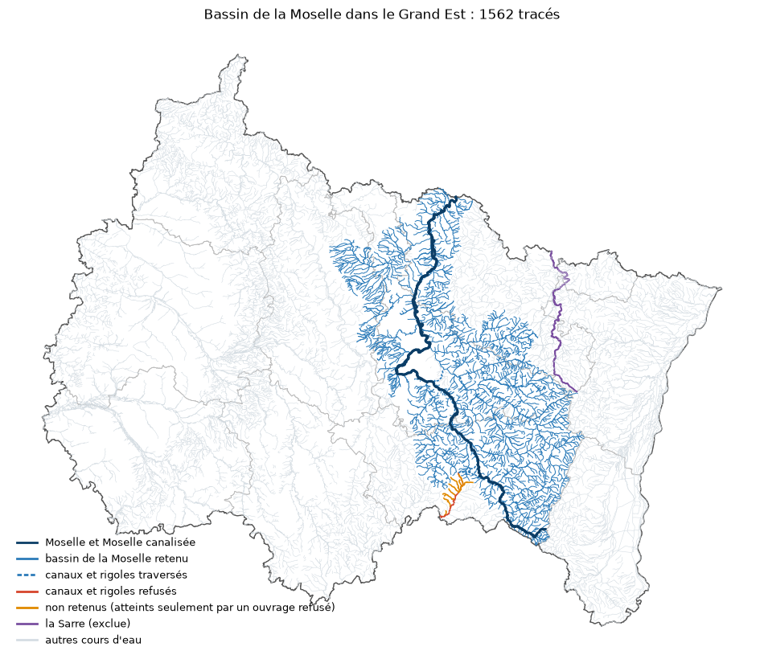

# Annexe technique

Toutes les étapes s'appuient uniquement sur les fichiers d'origine listés ci-dessous. Les données sont transformées par calcul, sans recours à une autre source.

## Sources des données

<!-- À compléter : liens vers la source, date de téléchargement, version. -->

## Étape 0 : vérification des fichiers d'origine

Avant toute préparation, le script `preparation/00_verifier_empreintes.py` calcule l'empreinte SHA-256 de chaque fichier d'origine et la compare à celle notée dans `preparation/empreintes.sha256`. Si un fichier manque ou diffère, le script s'arrête avec un message d'erreur : la suite de la préparation n'est donc faite qu'à partir des fichiers de référence.

| Fichier | Rôle |
| --- | --- |
| `donnees.csv` | mesures hebdomadaires (débit, pluie, température…) par site |
| `cours-eau-region_1791104972648.geojson` | tracé des cours d'eau du Grand Est |
| `region-grand-est.geojson` | contour de la région (fond de carte) |
| `departements-grand-est.geojson` | contours des départements (fond de carte) |

## Étape 1 : nettoyage de `donnees.csv`

Script : `preparation/01_nettoyer_donnees.py`. Le fichier est lu et écrit en texte, sans conversion automatique des types : les autres valeurs restent exactement celles d'origine. Deux corrections seulement :

1. **Abandon de la colonne `crue`** : elle vaut 1 sur les 370 538 lignes et n'apporte donc aucune information. Le script vérifie cette constance et s'arrête sinon.
2. **Zéro initial des Ardennes** : pour les 30 646 lignes du département des Ardennes (seul département concerné), le code `dept` vaut `8` au lieu de `08` et le code `commune` n'a que 4 chiffres (par exemple `8090` au lieu de `08090`). Le zéro est rétabli. Le script vérifie la forme attendue avant de corriger, puis que tous les codes ont ensuite leur longueur normale (2 caractères pour `dept`, 5 pour `commune`).

Les valeurs de débit nulles ou égales à -1 (code d'erreur) ne sont pas modifiées à cette étape : elles sont traitées au moment des calculs.

Contrôle : comparaison valeur par valeur du fichier produit avec l'original. Les seules différences sont l'absence de la colonne `crue` et le zéro ajouté aux codes des Ardennes ; l'écart de taille entre les deux fichiers (679 789 octets) correspond exactement à ces changements.

Remarque : un site de l'Aube est rattaché au libellé de département `AUBE,COTE-D'OR` (1 393 lignes). Ce libellé n'est pas modifié.

## Étape 2 : bassin de la Moselle

Script : `preparation/02_bassin_moselle.py`. Journal : `preparation/journaux/02_bassin_moselle.txt`.

Le fichier des cours d'eau contient 8 929 tracés, chacun avec un nom (`TopoOH`) et un identifiant unique (`CdOH`). Il ne dit ni quel cours d'eau se jette dans quel autre, ni dans quel sens l'eau s'écoule. On s'appuie donc sur la géométrie : **un affluent se termine sur le tracé du cours d'eau qui le reçoit**.

1. Les tracés sont reprojetés en Lambert-93 (EPSG:2154) pour mesurer les distances en mètres.
2. Pour chaque tracé, on calcule ses extrémités, une fois ses morceaux raccordés.
3. On note « A se termine sur B » quand une extrémité de A est à moins de 1 m du tracé de B. Le tracé est topologiquement propre : les extrémités tombent exactement sur l'autre tracé.
4. On part de la Moselle et de la Moselle canalisée, puis on **remonte** : on ajoute tout tracé qui se termine sur un tracé déjà retenu, et ainsi de suite. On ne fait que remonter : un tracé sur lequel se termine un cours d'eau du bassin n'est pas ajouté.
5. **Exclusions.** La Sarre est exclue (choix du projet), et avec elle tout son sous-bassin, qui n'est atteint que par elle. Les tracés dont le nom contient « canal » ou « rigole », appelés ici « ouvrages », ne sont pas traversés à ce stade, parce qu'ils peuvent relier des bassins entre eux. Les **bras sont gardés** : dans le tracé, la Seille se termine sur le « Bras Mort Aval de la Moselle ». Exclure les bras ferait perdre tout le sous-bassin de la Seille (224 tracés).
6. **Ouvrages traversés.** Certains ruisseaux n'atteignent le bassin que par un ouvrage. Pour chaque ouvrage qui touche le bassin, on regarde les cours d'eau qu'il apporterait :
   - si **aucun** de ces cours d'eau ne se termine aussi sur un cours d'eau extérieur au bassin, l'ouvrage est traversé et ils sont ajoutés ;
   - sinon, l'ouvrage est refusé.

   On répète jusqu'à ce que plus rien ne change, car un ouvrage traversé peut en faire toucher un autre. Les ouvrages eux-mêmes ne font pas partie du résultat.

Sans traverser d'ouvrage, la remontée retient 1 533 tracés. Sur les 24 ouvrages examinés, 23 sont traversés et 6 d'entre eux apportent des cours d'eau :

| Ouvrage traversé | Cours d'eau apportés | Contact avec le bassin (longitude, latitude) |
| --- | --- | --- |
| Canal de Flottage des Salines | 17 | 6,589 ; 48,786 |
| Canal de l'Est (Branche Sud) | 7 | 6,100 ; 48,608 |
| Canal des Usines | 2 | 6,715 ; 48,187 |
| Canal de Morteau | 1 | 6,370 ; 48,577 |
| Rigole d'Alimentation du Bassin de Virement | 1 | 6,182 ; 48,578 |
| Rigole d'Alimentation du Reservoir de Bouzey | 1 | 6,357 ; 48,167 |

Un seul ouvrage est refusé : le « Canal de l'Est » (contact en 6,304 ; 48,172). Il apporterait 11 ruisseaux, mais l'un d'eux, le « Ruisseau des Sept Pêcheurs », se termine aussi sur « le Coney », qui n'est pas dans le bassin. Le détail de chaque ouvrage est dans le journal.

**Résultat : 1 562 tracés**, soit 1 444 noms distincts, Moselle et Moselle canalisée comprises.

**Contrôle.** On repère dans le tracé tous les « exutoires » hors bassin, c'est-à-dire les cours d'eau qui ne se terminent sur aucun autre : il y en a 599. Pour chacun, on remonte son bassin de la même façon. Aucun de ces bassins n'a de tracé en commun avec celui de la Moselle.

**Limites.**
- Le tracé est coupé aux limites du Grand Est. Un affluent qui rejoint la Moselle hors de la région n'est pas détecté.
- Le rattachement suppose que la confluence est dessinée dans le tracé. Un ruisseau qui ne touche aucun autre tracé reste isolé.

## Étape 3 : rapprochement des noms entre le CSV et le GeoJSON

<!-- À venir. -->

## Étape 4 : filtrage des mesures

<!-- À venir. -->
