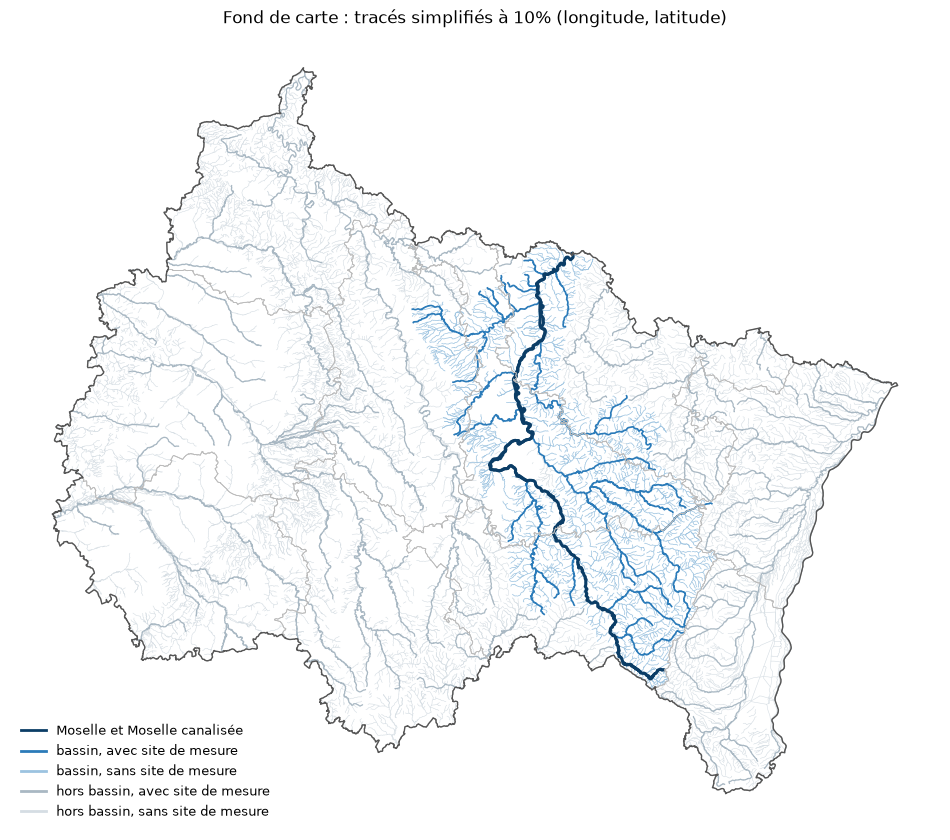

<a class="retour-dataviz" href="./">← Retour à la visualisation</a>

# Annexe technique

Cette annexe technique mentionne les outils utilisés pour créer la data visualisation, et décrit les transformations de données effectuées.

## Outils

Cette application de data visualisation a été développée avec [Observable Framework](https://observablehq.github.io/framework/) et l’assistance de [Claude Code](https://claude.com/fr/product/claude-code). Dans une phase préalable, l’exploration des données a été réalisée dans un [notebook Observable](https://observablehq.com/@observablehq/notebooks-user-guide) avec le soutien de [Claude](https://claude.com/fr/product/overview).

## Données

Conformément au [règlement du concours](https://www.datagrandest.fr/site/concours-de-datavisualisation-2026-informations-et-inscriptions/), seules les données mises à disposition dans le cadre du concours ont été utilisées pour créer cette application. Toutefois, compte tenu de leurs multiples dimensions (temps, site, cours d’eau…), elles ont fait l’objet de transformations significatives afin de pouvoir par exemple produire des valeurs à l’échelle des cours d’eau à partir de valeurs mesurées au niveau des stations.

En conséquence, les valeurs affichées sur les graphiques ne sont pas directement celles contenues dans les jeux de données mis à disposition. Afin de démontrer que le règlement du concours a été respecté, et dans un souci de transparence et de reproductibilité des transformations qui conduisent des données originales aux données affichées, cette annexe présente toutes les étapes de ces transformations. Le code qui permet de reproduire ces transformations a été publié dans un dépôt GitHub privé accessible sur demande. Il sera rendu public après la clôture du concours.

## Étape 0 : Téléchargement et vérification des fichiers d’origine

Toutes les données mises à disposition dans le cadre du concours se trouvent sur [cette page web](https://www.datagrandest.fr/datahub/dataset/a9557bbf-673a-4936-a01e-6f250554b33f). Au 24 octobre 2026, la page listait 5 fichiers de données et 2 fichiers PDF d’explication :
- `communes-grand-est.geojson`
- `departements-grand-est.geojson`
- `region-grand-est.geojson`
- `cours-eau-region_1791104972648.geojson`
- le fichier `donnees.zip` contenant lui-même 2 fichiers - `donnees.csv` et `donnees.xlsx`
- `Me_Lire.pdf`
- `Me_Lire_1791105003994.pdf`

Dans le salon Discord consacré au concours, les organisateurs ont précisé que les valeurs du champ `debit` du fichier `donnees` sont en réalité exprimées en l/s et non en m3/s comme inscrit dans `Me_Lire.pdf`.

Les fichiers de données suivants ont été utilisés pour créer l’application.

| Fichier | Rôle |
| --- | --- |
| `donnees.csv` | mesures hebdomadaires (débit, pluie, température…) par site |
| `cours-eau-region_1791104972648.geojson` | tracé des cours d’eau du Grand Est |
| `region-grand-est.geojson` | contour de la région (fond de carte) |
| `departements-grand-est.geojson` | contours des départements (fond de carte) |

Avant toute transformation, le script `preparation/00_verifier_empreintes.py` calcule l’empreinte SHA-256 de chaque fichier d’origine et la compare à celle notée dans `preparation/empreintes.sha256`. Si un fichier manque ou diffère, le script s’arrête avec un message d’erreur. Les transformations ne sont donc effectuées qu’à partir des fichiers dans leur état d’origine, c’est-à-dire tels que publiés sur [cette page web](https://www.datagrandest.fr/datahub/dataset/a9557bbf-673a-4936-a01e-6f250554b33f).

## Étape 1 : nettoyage de `donnees.csv`

Le script `preparation/01_nettoyer_donnees.py` effectue deux opérations :

1. **Abandon de la colonne `crue`**. Tous les sites de mesure couverts par `donnees.csv` sont utilisés pour la prévision des crues, et la colonne correspondante prend toujours la valeur `1`, donc elle n’apporte pas d’information utile pour notre analyse. Nous la supprimons.
2. **Rajout du zéro initial pour les codes liés aux Ardennes** : les codes `dept` et `commune` liés aux Ardennes ont un chiffre en moins (`8` au lieu de `08` et par exemple `8090` au lieu de `08090`) car le zéro initial a probablement disparu quand ces codes ont été considérés comme des nombres. Nous le rajoutons.

Les valeurs de débit vides ou égales à -1 (erreur) ne sont pas modifiées à cette étape, et seront traitées au moment des calculs.

Un site de l’Aube est rattaché au libellé de département `AUBE,COTE-D'OR` (1 393 lignes). Ce libellé n’est pas modifié.

## Étape 2 : identification des cours d’eau à rattacher au bassin de la Moselle

Script : `preparation/02_bassin_moselle.py`. Journal : `preparation/journaux/02_bassin_moselle.txt`.

Le fichier des cours d’eau `cours-eau-region_1791104972648.geojson` contient 8 929 tracés, chacun avec un nom (`TopoOH`) et un identifiant unique (`CdOH`). Il ne dit ni quel cours d’eau se jette dans quel autre, ni dans quel sens l’eau s’écoule. Pour identifier les affluents et sous-affluents de la Moselle, nous nous appuyons donc sur la géométrie : **un affluent se termine sur le tracé du cours d’eau qui le reçoit**.

1. Les tracés sont reprojetés en Lambert-93 (EPSG:2154 – système de coordonnées de référence officiel en France métropolitaine) pour mesurer les distances en mètres.
2. Pour chaque tracé, on calcule ses extrémités, une fois ses morceaux raccordés.
3. On note « A se termine sur B » quand une extrémité de A est à moins de 1 m du tracé de B. Le tracé est topologiquement propre : les extrémités tombent exactement sur l’autre tracé.
4. On part de la Moselle et de la Moselle canalisée, puis on remonte : on ajoute tout tracé qui se termine sur un tracé déjà retenu, et ainsi de suite. On ne fait que remonter : un tracé sur lequel se termine un cours d’eau du bassin n’est pas ajouté.
5. **Exclusions.** La Sarre et son bassin ne sont pas inclus car la Sarre se jette dans la Moselle en Allemagne, en aval du site de mesure le plus en aval sur la partie française de la Moselle. Les tracés dont le nom contient « canal » ou « rigole », appelés ici « ouvrages », ne sont pas pris en compte à ce stade parce qu’ils peuvent relier des bassins entre eux. En revanche, bien que les tracés fassent apparaître la Seille comme se terminant sur le « Bras Mort Aval de la Moselle », nous l’incluons avec son bassin car la Seille communique avec la Moselle.

6. **Ouvrages traversés.** Certains ruisseaux n’atteignent le bassin que par un ouvrage. Pour chaque ouvrage qui touche le bassin, on regarde les cours d’eau qu’il apporterait. Les cours d’eau associés à un ouvrage ne sont inclus que si aucun de ces cours d’eau ne se termine aussi sur un cours d’eau extérieur au bassin. Les ouvrages eux-mêmes ne font pas partie du résultat.

Sans traverser d’ouvrage, la remontée retient 1 533 tracés. Sur les 24 ouvrages examinés, 23 sont traversés et 6 d’entre eux apportent des cours d’eau :

| Ouvrage traversé | Cours d’eau apportés | Contact avec le bassin (longitude, latitude) |
| --- | --- | --- |
| Canal de Flottage des Salines | 17 | 6,589 ; 48,786 |
| Canal de l’Est (Branche Sud) | 7 | 6,100 ; 48,608 |
| Canal des Usines | 2 | 6,715 ; 48,187 |
| Canal de Morteau | 1 | 6,370 ; 48,577 |
| Rigole d’Alimentation du Bassin de Virement | 1 | 6,182 ; 48,578 |
| Rigole d’Alimentation du Reservoir de Bouzey | 1 | 6,357 ; 48,167 |

Un seul ouvrage est refusé : le « Canal de l’Est » (contact en 6,304 ; 48,172). Il apporterait 11 ruisseaux, mais l’un d’eux, le « Ruisseau des Sept Pêcheurs », se termine aussi sur « le Coney », qui n’est pas dans le bassin. Le détail de chaque ouvrage est dans le journal.

**Résultat : 1 562 tracés**, soit 1 444 noms distincts, Moselle et Moselle canalisée comprises.

**Contrôle.** On repère dans le tracé tous les « exutoires » hors bassin, c’est-à-dire les cours d’eau qui ne se terminent sur aucun autre : il y en a 599. Pour chacun, on remonte son bassin de la même façon. Aucun de ces bassins n’a de tracé en commun avec celui de la Moselle.

## Étape 3 : rapprochement des noms entre le CSV et le GeoJSON

Script : `preparation/03_rapprocher_noms.py`. Journal : `preparation/journaux/03_rapprocher_noms.txt`.

Les fichiers `donnees.csv` et `cours-eau-region_1791104972648.geojson` ne désignent pas les cours d’eau de la même façon. `donnees.csv` utilise un code (`code_cours_eau`) et un libellé (`libelle_cours_eau`), le GeoJSON un nom (`TopoOH`). On rattache donc chaque site de mesure à un tracé en combinant le nom et la position. On sait ensuite, grâce à l’étape 2, si le site est dans le bassin de la Moselle.

**Précision des positions.** Les coordonnées des sites sont arrondies à 2 décimales en latitude et à 3 en longitude. La vraie position peut donc être éloignée de la position arrondie d’un demi-pas d’arrondi dans chaque direction, soit 556 m vers le nord ou le sud et 36 m vers l’est ou l’ouest. La limite de distance acceptée entre un site et son tracé en découle : **558 m**.

**Normalisation des noms.** On retire les accents, on met en minuscules, on remplace l’apostrophe typographique par l’apostrophe droite et on réduit les espaces multiples. Exemple : « La Moselle Canalisee » (CSV) et « la Moselle Canalisée » (GeoJSON) deviennent identiques.

**Règles, appliquées site par site :**

1. **Même nom** : parmi les tracés dont le nom normalisé est identique au libellé du cours d’eau, on prend le plus proche du site, s’il est sous la limite de distance. 262 sites sont rattachés ainsi.
2. **Mot commun** : sinon, on prend le tracé le plus proche, sous la limite de distance, dont le nom partage un mot distinctif avec le libellé du cours d’eau ou avec le nom écrit dans le libellé du site (la partie avant « à »). Les mots comme « ruisseau », « le », « la » ou « de » sont ignorés. 3 sites sont rattachés ainsi :

| Site | Libellé du cours d’eau | Tracé rattaché | Distance |
| --- | --- | --- | --- |
| La Béhine à Lapoutroie | La Bechine | la Béhine | 100 m |
| L'Eberbach à Leutenheim | Ruisseau l'Eberbach | Eberbach | 34 m |
| Le Veymerange à Thionville | Ruisseau le Veymerange | Ruisseau de Veymerange | 346 m |

3. Sinon, le site reste non rattaché. C’est le cas d’un seul site, « [Source de Flanrupt] à Bourbonne-les-Bains », qui n’a ni code de cours d’eau (`0`) ni libellé.

**Homonymes.** Plusieurs tracés peuvent porter le même nom. C’est la position qui départage. Par exemple, le site « L'Horn à Bousseviller » est rattaché au tracé « la Horn » situé à 271 m, qui n’est pas dans le bassin de la Moselle, et non à son homonyme qui s’y trouve. Un seul site a deux tracés de même nom sous la limite (« La Marne à Joinville », à 4 m et à 68 m). Le plus proche est retenu, et ce site n’est pas dans le bassin de la Moselle.

**Contrôles.**
- Les coordonnées et libellés de chaque site sont identiques sur toutes ses lignes.
- Tous les sites d’un même code de cours d’eau sont soit tous dans le bassin, soit tous dehors.

**Résultat : 64 sites dans le bassin de la Moselle, sur 31 cours d’eau**, dont 11 sites sur la Moselle et 2 sur la Moselle canalisée. La liste complète est dans le journal.

## Étape 4 : filtrage des mesures

Script : `preparation/04_filtrer_mesures.py`.

On ne garde que les lignes de `donnees.csv` (nettoyé à l’étape 1) dont le site est rattaché, à l’étape 3, au tracé de la Moselle ou de la Moselle canalisée. Les 51 sites des affluents ne servent ni aux calculs ni à l’affichage : ils ne sont pas gardés. Ces lignes sont réparties en trois fichiers, pour ne pas répéter à chaque semaine les informations qui ne changent pas. Ce sont les données de l’application, dans `src/data/` :

| Fichier | Une ligne par | Colonnes | Lignes |
| --- | --- | --- | --- |
| `sites.csv` | site | site, libelle_site, code_cours_eau, libelle_commune, commune, dept, libelle_dept, lat, lon, etiage, et le tracé rattaché à l’étape 3 (CdOH, TopoOH, distance_m) | 13 |
| `cours_eau.csv` | cours d’eau | code_cours_eau, uri_cours_eau, libelle_cours_eau | 2 |
| `mesures.csv` | site et semaine | semaine, site, temp, pluie, neige, debit, humidite, date | 18 109 |

Jointures : `mesures.site` → `sites.site`, puis `sites.code_cours_eau` → `cours_eau.code_cours_eau`. Les fichiers sont lus et écrits en texte : les valeurs restent exactement celles de l’étape 1, zéros initiaux compris.

**Contrôles.**
- Les colonnes de `sites.csv` sont constantes pour chaque site, et celles de `cours_eau.csv` pour chaque cours d’eau.
- Chaque site a exactement une ligne par semaine : 1 393 semaines, de 2000W01 à 2026W37, soit 13 × 1 393 = 18 109 lignes.
- **Jointure complète** : en recollant les trois fichiers écrits, on retrouve exactement les 18 109 lignes de l’étape 1 pour ces sites.

**À savoir pour les calculs.** Dans `mesures.csv`, 3 692 valeurs de `debit` sont vides (sites qui n’ont pas de mesures sur toute la période). Aucune valeur n’est nulle ni négative. Les débits nuls du jeu de données sont de vraies mesures (cours d’eau à sec, ou « assec ») : ils concernaient des sites d’affluents, qui ne sont plus gardés. Les règles de l’étape 6 pour les débits nuls restent appliquées par le code, mais ne se déclenchent pas sur ces données. La valeur -1 (erreur) n’apparaît pas pour ces sites. Les autres paramètres observés (temp, pluie, neige, humidite) n’ont aucune valeur vide.

## Étape 5 : carte

Script : `preparation/05_fonds_de_carte.py`. Journal : `preparation/journaux/05_fonds_de_carte.txt`.

**Cours d’eau.** Tous les tracés de la région sont gardés pour la carte, avec leur catégorie :

| Catégorie | Contenu |
| --- | --- |
| `moselle` | la Moselle et la Moselle canalisée |
| `bassin` | les autres tracés du bassin de la Moselle (étape 2), c’est-à-dire ses affluents |
| `hors_bassin` | tous les autres tracés de la région |

Pour réduire les temps de chargement, les dessins des tracés sont simplifiés avec l’outil [mapshaper](https://github.com/mbloch/mapshaper). La version utilisée (0.7.95) et les paramètres de la simplification sont indiqués dans `package.json` :

- `-simplify 10% keep-shapes` : on garde 10 % des sommets qui peuvent être supprimés, sans faire disparaître de tracé ;
- `precision=0.0001` : les coordonnées sont arrondies à 0,0001°, soit environ 10 m ;
- `-filter remove-empty`, dans un second passage : on retire les objets devenus vides avec l’arrondi. C’est le cas d’un seul tracé, « Ruisseau de Rebais », qui n’a que 2 sommets distants de 0,00001°.

**Regroupement des tracés.** La carte dessine tous les tracés d’une même catégorie de la même façon. Après la simplification, on les regroupe donc en un seul objet (`MultiLineString`) par catégorie, sans identifiant ni nom. Le regroupement ne change aucune coordonnée : le script vérifie que les lignes et le nombre de sommets sont identiques avant et après.

**Région et départements.** Ils ne sont pas simplifiés : leurs coordonnées sont seulement arrondies de la même façon. Avec l’option `gj2008`, mapshaper garde le sens des contours des fichiers d’origine (contour extérieur dans le sens des aiguilles d’une montre), qui est celui qu’attend la bibliothèque d3. Sans cette option, mapshaper suit la norme GeoJSON RFC 7946 (sens inverse), et d3 dessinerait le reste du globe au lieu de la région.

**Résultat** (dans `src/data/`) :

| Fichier | Contenu | Taille |
| --- | --- | --- |
| `traces_cours_eau.geojson` | 3 objets, un par catégorie, qui regroupent 8 928 tracés : 2 Moselle, 1 560 bassin, 7 366 hors bassin | 4,2 Mo |
| `region.geojson` | contour de la région | 0,09 Mo |
| `departements.geojson` | 10 départements | 0,31 Mo |

**Contrôles.** Le script vérifie la version de mapshaper. Il vérifie aussi que tous les tracés du bassin sont présents après simplification.

À partir de ces fichiers et de `sites.csv`, la carte  est dessinée en SVG avec la bibliothèque d3 (code : `src/components/carte.js`).

- **Cours d’eau** : trois couches, une par catégorie. La Moselle est en bleu sombre (`#0b4f71`, trait épais), les affluents en bleu (`#2b7bb9`, trait de 1,2 pixel) et les autres cours d’eau, avec ou sans site de mesure, dans le même bleu estompé (35 % d’opacité).
- **Sites de mesure** : seuls les sites de la Moselle et de la Moselle canalisée sont dessinés. Les sites des affluents ne sont pas affichés. Au survol, le nom du site apparaît.

- **Projection** : conique conforme de Lambert, avec les parallèles 44° et 49° et le méridien 3° E.

## Étape 6 : profil le long de la Moselle

Script : `preparation/06_profil_moselle.py`. Journal : `preparation/journaux/06_profil_moselle.txt`. Contrôle : `preparation/06b_verifier_indice.py`.

À travers cette étape, nous cherchons à situer les sites de mesure sur la Moselle et à calculer la distance qui les sépare, de façon à pouvoir afficher cette distance quand nous montrons les valeurs des mesures de débit aux différents sites.

**Distance de chaque site le long de la Moselle.**
- Le tracé « la Moselle » est formé de 4 morceaux, avec une petite fourche. On en fait un graphe : les sommets sont les bouts des morceaux, les arêtes les morceaux, pondérées par leur longueur. On garde le plus long des plus courts chemins entre deux bouts libres, soit **314,3 km** dans la région.
- Les sites de la Moselle et de la Moselle canalisée sont projetés sur ce chemin. Ils en sont tous à moins de 420 m, sous le seuil de l’étape 3. Les deux sites de la Moselle canalisée en sont à 0 et 27 m : on mesure donc tout le long du même tracé.
- La distance d’un site est la longueur du chemin entre l’extrémité amont et son point projeté. Elle est mesurée depuis l’extrémité amont **du tracé dans la région**.
- **Sens d’écoulement.** Le fichier ne dit pas de quel côté est l’amont. On le déduit des débits, puisque le débit médian augmente vers l’aval. La corrélation de rang (Spearman) entre la distance depuis la première extrémité et le débit médian vaut **-0,993**. L’amont est donc l’autre extrémité (6,892 ; 47,890), et l’aval est en (6,367 ; 49,467).
- Le site « La Moselle à Metz [Pont des Morts] » n’a **aucun débit valide** sur toute la période : il est écarté. Le profil compte **12 sites**, de 12,1 à 283,0 km.

**Sites retenus pour les calculs.** Un débit est **valide** s’il est renseigné et positif ou nul. Un débit nul est une vraie mesure (cours d’eau à sec, « assec ») et il est gardé dans toutes les analyses ; seuls les débits vides et le code d’erreur -1 sont écartés. Pour que les semaines extrêmes et le débit médian reposent sur des séries comparables, seuls les sites qui ont une série presque complète servent aux calculs. Un site est retenu s’il remplit les trois critères suivants :
1. son premier débit valide date au plus tard de la semaine 2001W01, c’est-à-dire de la première année du jeu de données ;
2. il a un débit valide la dernière semaine du jeu de données (2026W37, 7 septembre 2026), donc pas d’interruption avant la fin ;
3. au moins **97 %** des 1 393 semaines ont un débit valide.

| Site | 1ʳᵉ semaine valide | Dernière | Semaines valides | Retenu |
| --- | --- | --- | --- | --- |
| Fresse-sur-Moselle | 2000W01 | 2026W37 | 100 % | oui |
| Rupt-sur-Moselle | 2000W01 | 2026W37 | 98,1 % | oui |
| Remiremont et Saint-Nabord | 2000W01 | 2026W37 | 99,5 % | oui |
| Épinal | 2000W01 | 2026W37 | 100 % | oui |
| Châtel-sur-Moselle | 2014W42 | 2026W37 | 44,7 % | non |
| Saint-Mard, Tonnoy et Velle-sur-Moselle | 2001W01 | 2026W27 | 95,3 % | non |
| Pont-Saint-Vincent | 2000W01 | 2026W37 | 99,8 % | oui |
| Toul | 2000W01 | 2026W37 | 99,6 % | oui |
| Custines | 2000W01 | 2026W37 | 100 % | oui |
| Corny-sur-Moselle | 2014W17 | 2026W37 | 46,3 % | non |
| Hagondange et Hauconcourt | 2012W48 | 2026W37 | 51,7 % | non |
| Uckange | 2000W01 | 2026W37 | 100 % | oui |

**8 sites sont retenus.** Aucun site n’a une part de semaines valides comprise entre 95,3 % et 98,1 %. Le seuil exact, autour de 97 %, ne change donc pas le résultat.

**Comparaison entre semaines.** Comparer les semaines et identifier les extrêmes à l’échelle d’un cours d’eau suppose de disposer d’une méthode d’agrégation des mesures au niveau des sites correspondant à ce cours d’eau. Pour chaque semaine, on calcule la moyenne géométrique, sur les sites retenus mesurés cette semaine-là, de (débit / débit médian du site). 1 = débit habituel aux sites, 2 = deux fois plus, 0,5 = deux fois moins.
Le débit médian d’un site est la médiane de ses débits valides, zéros compris.

**Débits nuls et logarithme.** La moyenne géométrique se calcule avec le logarithme, qui n’existe pas pour 0. Pour ce calcul uniquement, un débit nul (ou un débit médian nul) est remplacé par un **plancher propre au site** : la moitié de son plus petit débit strictement positif. Chaque remplacement est signalé : le nombre de débits nuls et le plancher de chaque site figurent dans `profil_sites.csv`, et le nombre de remplacements de chaque semaine dans `profil_semaines.csv`. Pour la Moselle, il n’y a aucun débit nul : aucun remplacement n’est fait, et les résultats sont les mêmes qu’en écartant les zéros. La règle a été testée en mettant temporairement deux débits d’Épinal à 0 : le site reste valide à 100 %, les deux semaines sont signalées, et le contrôle numpy retrouve le même indice.

- **Semaine du maximum : 1ᵉʳ janvier 2018** (indice 11,8).
- **Semaine du minimum : 10 août 2026** (indice 0,083).

**Contrôle.** Le script `06b_verifier_indice.py` refait le calcul autrement, avec numpy, sous forme de tableau semaines × sites retenus. Il recalcule lui-même le plancher de chaque site, et retrouve le même nombre de sites et de remplacements pour chaque semaine, le même indice à 5·10⁻⁷ près (arrondi du fichier à 6 décimales) et les mêmes semaines extrêmes.

**Fichiers produits** (dans `src/data/`) :
- `profil_sites.csv` : site, libellé, distance, débit médian, nombre de débits valides, nombre de débits nuls, plancher pour le logarithme, première et dernière semaines valides, part de semaines valides, site retenu ou non pour les calculs, écart au tracé ;
- `profil_semaines.csv` : semaine, date, nombre de sites mesurés, indice, semaine classée ou non, nombre de débits nuls remplacés par le plancher ;
- `profil_debits.csv` : site, semaine et débit, pour les 12 sites du profil et leurs seuls débits valides (14 417 lignes, 0,36 Mo). C’est le seul fichier de mesures que lit la page : elle n’envoie ainsi pas au navigateur les autres colonnes de `mesures.csv` (températures, pluie, neige, humidité), déjà résumées par l’étape 7 ;
- `moselle_extremites.csv` : longitude et latitude des deux extrémités du chemin principal de la Moselle (amont et aval), où la carte place la source et la sortie du territoire français.

**Graphique des débits**

Le graphique (code : `src/components/profil.js`) montre le débit à chaque site de la Moselle, d’amont en aval, avec la distance en abscisse. **Chaque courbe correspond à une même semaine.** Un site sans mesure cette semaine-là n’a pas de point. Les **calculs**, eux, ne tiennent compte que des 8 sites avec série complète : l’indice, le classement, le choix des semaines extrêmes et la courbe du débit médian.

| Courbe | Couleur |
| --- | --- |
| « Semaine affichée » : semaine choisie avec la barre placée sous le graphique (au chargement, le 3 juillet 2017) | `#0b4f71`, trait épais |
| débit médian de chaque site retenu, toutes semaines confondues (« Débit médian du site* » dans la légende ; l’astérisque renvoie aux sites retenus) | gris, en tirets |

- **Échelle** linéaire par défaut, ou logarithmique (case « Échelle log. »), avec des graduations 1-3-10. Les bornes de l’axe sont fixes, quelle que soit la semaine. Un débit nul ne peut pas être placé sur une échelle logarithmique : il y est dessiné au plancher du site, avec un **point creux** pour le signaler. En échelle linéaire, il est placé à 0. Aucun débit nul n’apparaît sur la Moselle.
- **Lignes verticales** : une par site de mesure, à sa distance depuis l’amont. Elles sont pleines pour les 8 sites retenus pour les calculs et en pointillés pour les 4 autres, dont la série est incomplète. Au passage de la souris, la ligne se renforce et le site correspondant est mis en évidence sur la carte.

## Étape 7 : température, pluie et neige

Script : `preparation/07_meteo_moselle.py`. Journal : `preparation/journaux/07_meteo_moselle.txt`.

Les deux graphiques météo portent sur les **12 sites du profil des débits** (étape 6). Les trois mesures utilisées sont :
- `temp` : température moyenne hebdomadaire (°C) ;
- `pluie` : hauteur de pluie, cumul hebdomadaire (mm) ;
- `neige` : équivalent en eau des précipitations solides (neige, grêle), cumul hebdomadaire (mm).

Les mesures de pluie et la neige ont donc la même unité mais elles restent traitées distinctement.

**Moyenne hebdomadaire.** Pour chaque semaine, on calcule la moyenne des mesures de chacun des 12 sites.

**Moyennes interannuelles hebdomadaires.** Pour chaque semaine de l’année (numéro de semaine ISO), on calcule la moyenne des moyennes hebdomadaires de cette semaine sur toutes les années du jeu de données (2000 à 2026), soit 26 ou 27 années selon la semaine. La semaine 53, qui n’existe que certaines années (2004, 2009, 2015 et 2020), est regroupée avec la semaine 52, qui compte ainsi 30 valeurs. La définition de ces moyennes interannuelles se rapproche de celle des normales climatiques, mais ces dernières se calculent sur 30 ans alors que nous ne disposons de données que sur 26 ans.

**Fichier produit** : `src/data/meteo_semaines.csv`, avec une ligne par semaine : semaine, date, semaine de l’année, moyennes des 12 sites (temp, pluie, neige) et références (temp_ref, pluie_ref, neige_ref).

**Graphiques** : `src/components/meteo.js`.
Les deux graphiques affichent les moyennes hebdomadaires, en haut de température, en bas de pluie et neige, pour la semaine sélectionnée et les 4 semaines précédentes. Ils montrent aussi en pointillés les moyennes interannuelles hebdomadaires sur la période 2000-2026.

<a class="retour-dataviz" href="./">← Retour à la visualisation</a>